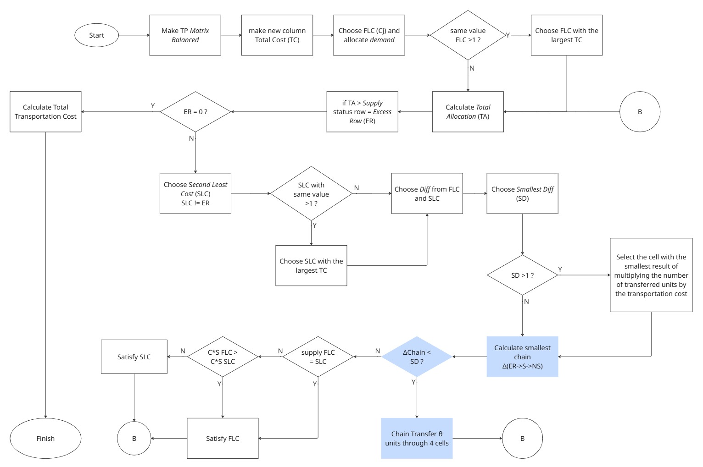
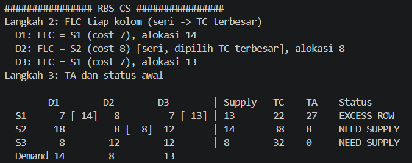
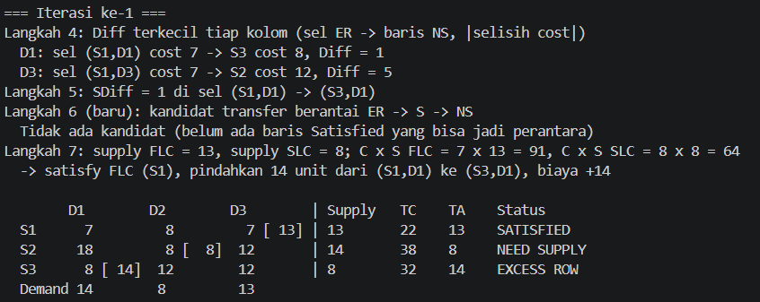
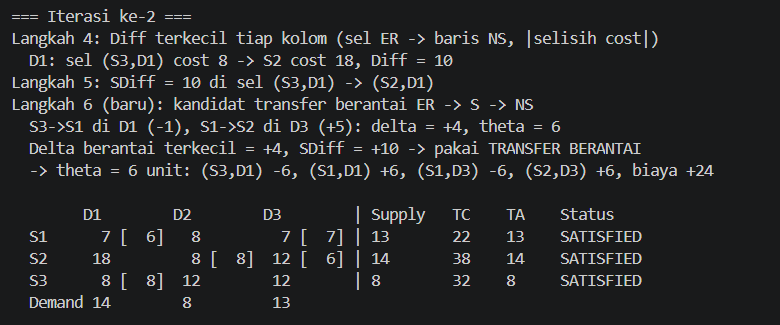
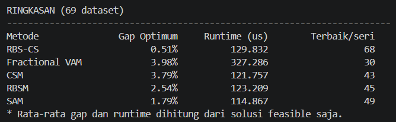

# RBS-CS: Pengembangan RBSM melalui Transfer Berantai untuk Masalah Transportasi

| Nama | NRP |
|--------------|-------------|
| Elraffa Abhinaya | 5025231194 |

## 1. TP, RBSM & RBS-CS

Masalah transportasi menentukan alokasi barang dari sejumlah sumber ke sejumlah tujuan dengan biaya minimum. Alokasi harus memenuhi kapasitas supply setiap sumber dan kebutuhan demand setiap tujuan.

RBSM (*Rihan–Bilqis–Saikhu Method*) merupakan pengembangan Supply Selection Method oleh Rihan Farih Bunyamin, Bilqis Amaliah, dan Ahmad Saikhu. Metode ini mengalokasikan demand pada sel termurah tiap kolom, kemudian memperbaiki baris yang kelebihan alokasi melalui transfer ke baris yang masih kekurangan.

RBS-CS menambahkan **transfer berantai melalui satu baris yang sudah Satisfied**. Baris perantara menerima alokasi pada suatu kolom dan melepaskan jumlah yang sama pada kolom lain. Tujuannya adalah menyediakan pilihan transfer dengan perubahan biaya yang lebih kecil.

## 2. Formulasi Masalah

Misalkan $c_{ij}$ adalah biaya per unit, $x_{ij}$ adalah jumlah alokasi, $s_i$ adalah supply, dan $d_j$ adalah demand. Dengan $m$ sumber dan $n$ tujuan, fungsi tujuannya adalah:

$$
\min Z=\sum_{i=1}^{m}\sum_{j=1}^{n}c_{ij}x_{ij}.
$$

Kendala:

$$
\sum_{j=1}^{n}x_{ij}=s_i\quad\forall i,\qquad
\sum_{i=1}^{m}x_{ij}=d_j\quad\forall j,\qquad x_{ij}\geq0.
$$

Jika total supply dan demand berbeda, masalah diseimbangkan dengan baris atau kolom dummy berbiaya nol.

## 3. Metode yang Dibandingkan

| Metode | Pendekatan utama |
|---|---|
| **RBS-CS** | Alokasi minimum kolom, lalu transfer langsung atau berantai |
| **Fractional VAM** | Pemilihan alokasi berdasarkan penalti rasio biaya |
| **CSM** | Redistribusi dengan prioritas biaya total baris dikali supply |
| **RBSM** | Alokasi minimum kolom, lalu transfer langsung antarbaris |
| **SAM** | Redistribusi dengan prioritas rata-rata biaya baris dikali supply |

## 4. Cara Kerja RBS-CS

### 4.1 Alokasi awal

Hitung total biaya setiap baris $TC_i=\sum_j c_{ij}$, kemudian alokasikan seluruh demand tiap kolom ke sel termurah. Jika biaya sama, pilih baris dengan TC lebih besar. Setelah itu, hitung total alokasi $TA_i=\sum_j x_{ij}$ dan tentukan status baris:

| Status | Kondisi |
|---|---|
| ER (*Excess Row*) | $TA_i>s_i$ |
| Satisfied | $TA_i=s_i$ |
| NS (*Need Supply*) | $TA_i<s_i$ |

Alokasi awal dapat memenuhi demand tetapi belum memenuhi supply, sehingga perlu diperbaiki.

### 4.2 Transfer langsung dan berantai

**Transfer langsung** memindahkan alokasi dari donor ER $i$ ke penerima NS $r$ pada kolom $j$. Perubahan biaya per unitnya adalah:

$$\delta_{\mathrm{direct}}=c_{rj}-c_{ij}.$$

Kandidat dan jumlah transfer mengikuti aturan RBSM lokal. Prioritas didasarkan pada biaya sel dikali supply, kemudian indeks baris jika nilainya sama. Jumlah transfer dibatasi alokasi sel donor dan selisih supply–TA baris prioritas. Aturan langsung ini dapat membuat penerima menjadi ER.

**Transfer berantai** memakai jalur ER $i$ → Satisfied $k$ → NS $r$. Donor memberikan alokasi pada kolom $j$, lalu perantara melepaskan alokasi pada kolom lain $l$:

$$
\delta_{\mathrm{chain}}=(c_{kj}-c_{ij})+(c_{rl}-c_{kl}).
$$

Jumlah unit yang dapat dipindahkan adalah:

$$
\theta=\min(TA_i-s_i,\ x_{ij},\ x_{kl},\ s_r-TA_r).
$$

Empat sel diperbarui: $x_{ij}$ dan $x_{kl}$ dikurangi $\theta$, sedangkan $x_{kj}$ dan $x_{rl}$ ditambah $\theta$. Dengan demikian, demand tetap terpenuhi dan total alokasi perantara tidak berubah.

Rantai dipilih jika $\delta_{\mathrm{chain}}<\delta_{\mathrm{direct}}$. Jika sama atau tidak tersedia rantai, digunakan transfer langsung. Proses diulang sampai tidak ada ER atau kondisi penghentian tercapai, lalu kelayakan alokasi diperiksa.

### 4.3 Flowchart

Gambar menunjukkan alur umum. Detail tie-break implementasi mengikuti kode lokal; cabang prioritas saat supply sama pada gambar masih mengikuti paper.

## 5. Contoh Perhitungan

Contoh memakai [G1_P07.txt](Assets/Dataset/69/G1_P07.txt).

Alokasi awal adalah S1–D1 = 14, S2–D2 = 8, dan S1–D3 = 13. Pada D2, S2 dipilih karena TC-nya lebih besar daripada S1. Biaya awal adalah **253**, tetapi S1 masih kelebihan alokasi.

**Iterasi pertama:** pindahkan 14 unit pada D1 dari S1 ke S3. Delta per unit adalah $8-7=1$, sehingga biaya menjadi $253+14(1)=267$. S1 menjadi Satisfied, S3 menjadi ER, dan S2 masih NS.

**Iterasi kedua:** bandingkan dua pilihan berikut.

| Pilihan | Delta per unit | Jumlah transfer | Tambahan biaya |
|---|---:|---:|---:|
| Langsung: S3 → S2 pada D1 | $18-8=10$ | 6 | 60 |
| Berantai: S3 → S1 pada D1, lalu S1 → S2 pada D3 | $(7-8)+(12-7)=4$ | 6 | 24 |

RBS-CS memilih rantai karena $4<10$, sehingga biaya menjadi $267+6(4)=291$. Seluruh supply dan demand terpenuhi.

Biaya dari alokasi akhirnya adalah:

$$Z=(7\times6)+(7\times7)+(8\times8)+(12\times6)+(8\times8)=291.$$

Pada kondisi iterasi kedua yang sama, RBSM menggunakan transfer langsung sebanyak 6 unit dengan delta 10, sehingga biaya akhirnya $267+6(10)=327$. RBS-CS menghemat **36 satuan atau 11,01%** dibandingkan RBSM pada contoh ini.

## 6. Benchmark dan Pembahasan

Pengujian memakai seluruh **69 dataset** pada folder [Assets/Dataset/69](Assets/Dataset/69). Biaya optimum diperiksa dengan solver min-cost flow terpisah. Untuk G6_N04, evaluasi menggunakan optimum terverifikasi **1.580**, karena angka referensi file 555 tidak sesuai dengan matriks lokal.

### 6.1 Kualitas solusi

| Metode | Feasible | Solusi optimal | Akurasi (%) | Rata-rata gap (%) |
|---|---:|---:|---:|---:|
| RBS-CS | 69/69 | 61/69 | 88,41 | 0,51 |
| Fractional VAM | 69/69 | 28/69 | 40,58 | 3,98 |
| CSM | 69/69 | 43/69 | 62,32 | 3,79 |
| RBSM | 69/69 | 44/69 | 63,77 | 2,54 |
| SAM | 67/69 | 48/69 | 69,57 | 1,79 |

Gap dihitung dengan:

$$\text{Gap}(\%)=\frac{Z_{\mathrm{metode}}-Z^*}{Z^*}\times100\%,$$

dengan $Z^*$ adalah biaya optimum. Rata-rata hanya menggunakan hasil feasible.

### 6.2 Perbandingan hasil

RBS-CS mencapai biaya yang sama dengan **optimum eksak pada 61 dari 69 kasus (88,41%)**, dengan rata-rata gap **0,5145%**. Pada kasus optimal tersebut, metode lain dapat menghasilkan biaya yang sama.

Dalam perbandingan kelima metode, RBS-CS memiliki **biaya terendah atau sama rendahnya dengan metode lain pada 68 kasus**. Jumlah ini terdiri dari **61 kasus optimal** dan **7 kasus yang belum optimal tetapi tidak dikalahkan oleh metode pembanding**. Jadi, angka 68 menyatakan hasil terbaik antarmetode, bukan jumlah solusi optimal maupun jumlah hasil seri.

Dibandingkan khusus dengan RBSM, biaya RBS-CS lebih rendah pada **23 kasus** dan sama pada **46 kasus**.

Hasil tersebut belum menjamin RBS-CS selalu unggul. Pada G6_P10, RBS-CS menghasilkan biaya 221, sedangkan fractional VAM dan SAM menghasilkan optimum 212.

SAM menghasilkan 67 solusi feasible. Pada G8_S05, alokasi belum memenuhi supply saat mencapai batas iterasi; pada G8_S06, ditemukan akses indeks di luar batas. Kedua hasil gagal tetap dicatat. Rata-rata gap SAM dihitung dari 67 kasus, sedangkan empat metode lainnya dari 69 kasus. Pada subset 67 kasus yang sama-sama feasible, RBS-CS tetap memiliki rata-rata gap terkecil, yaitu 0,4136%.

### 6.3 Iterasi dan runtime

| Metode | Rata-rata iterasi | Rata-rata runtime (µs) |
|---|---:|---:|
| RBS-CS | 6,25 | 129,832 |
| Fractional VAM | 14,55 | 327,286 |
| CSM | 6,20 | 121,757 |
| RBSM | 6,10 | 123,209 |
| SAM | 4,67 | 114,867 |

Tabel runtime mengikuti hasil eksekusi pada capture di atas. Pengukuran pada eksekusi berikutnya dapat menghasilkan waktu yang berbeda.

Runtime mencakup pembacaan input, inisialisasi, proses penyelesaian, dan penyalinan alokasi. Nilai per dataset adalah median lima pengukuran, kemudian dirata-ratakan pada hasil feasible. Angka ini dapat berubah antar eksekusi. Iterasi fractional VAM merupakan langkah alokasi, sedangkan metode lain menghitung langkah transfer, sehingga jumlahnya tidak langsung setara.

## 7. Kesimpulan

RBS-CS menambahkan transfer melalui satu baris Satisfied untuk memperluas pilihan perbaikan alokasi RBSM. Pada 69 dataset, metode ini menghasilkan seluruh solusi feasible, mencapai optimum pada **61 kasus**, dan memiliki rata-rata gap **0,5145%**. Biayanya lebih rendah daripada RBSM pada 23 kasus dan sama pada 46 kasus.

Hasil mendukung manfaat transfer berantai pada dataset yang diuji. Metode ini masih bersifat heuristik dan tidak menjamin optimum untuk semua input. Evaluasi berfokus pada kelayakan dan biaya; sifat basis setiap hasil belum diuji.

